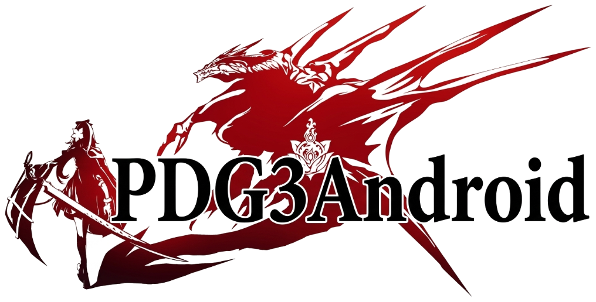
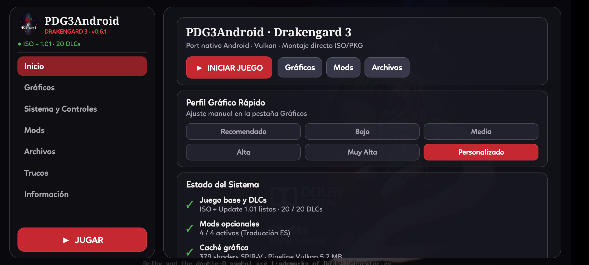
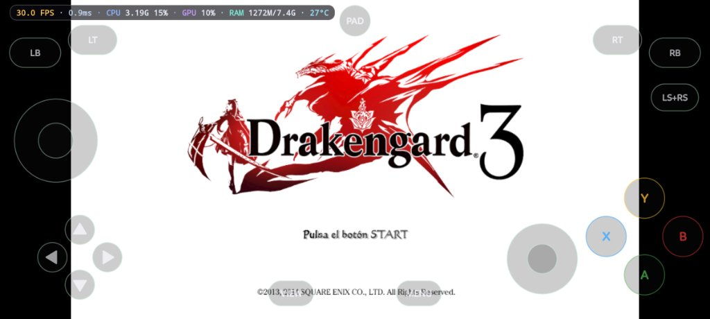
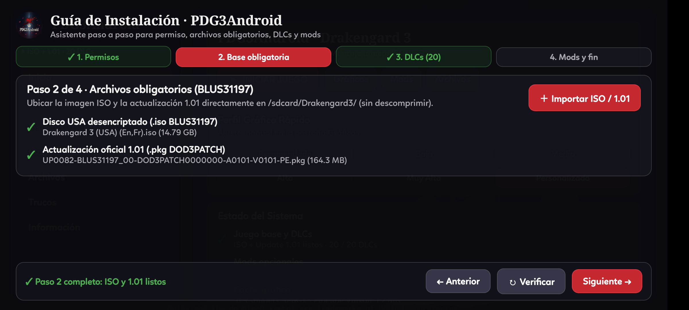
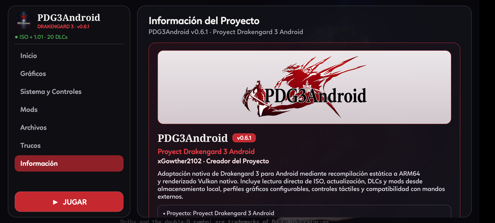
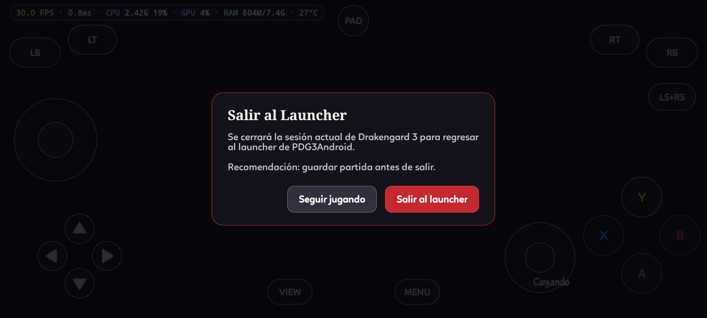

<p align="right">
  <a href="README.md">Español</a> | <b>English</b>
</p>

# PDG3Android — Proyect Drakengard 3 Android (PS3 → Android ARM64)

<p align="center">
  
</p>

> **Project Status:** **Active Development (`v0.6.1`)** — Playable and actively maintained with Vulkan renderer and Android launcher optimizations.  
> **Android Port Creator:** `xGowther2102` · Built upon static recompilation work from [dod3-recomp](https://github.com/soyjxck/dod3-recomp) and [ps3recomp](https://github.com/soyjxck/ps3recomp).

**PDG3Android** is a native Android port of **Drakengard 3 (BLUS31197)** built with **PPU/SPU static recompilation to ARM64** rather than traditional emulation. Original PlayStation 3 executable functions are statically lifted to 64-bit native C++ running on a custom HLE runtime, **native Vulkan**, **SPIR-V**, MP3/PCM audio, and a direct virtual filesystem reading `.iso`, `.pkg`, and mod archives without unpacking.

---

## General Stack & Base Repositories

### Core Architecture & Tooling
* **PPU / SPU Static Recompilation to ARM64:** static translation of PS3 executables to native C++ running directly on CPU without JIT overhead.
* **Native Vulkan Renderer + SPIR-V + PSO Cache:** persistent shader/pipeline cache, descriptor set caching, and post-processing passes.
* **Direct Virtual Filesystem (VFS):** on-the-fly reading from decrypted ISO, `1.01` update `.pkg`, DLC `.pkg` packs, and `.pkg` / `.zip` mods inside `/sdcard/Drakengard3/`.
* **Hybrid SDL2 Input + Touch Templates:** Bluetooth/USB controller support backed by `gamecontrollerdb.txt` and adaptive touch layouts.
* **Android Build Toolchain (`arm64-v8a`):** Android NDK (Clang/LLVM), CMake, Ninja, and Gradle with `:game` process isolation and crash/diagnostic export.

### Base Repositories & Technical Credits
* **★ [dod3-recomp](https://github.com/soyjxck/dod3-recomp) *(Main Repository)*:** Drakengard 3 static lifting, Unreal Engine 3 patches, and base launcher.
* **[ps3recomp (Main Runtime Fork)](https://github.com/soyjxck/ps3recomp):** HLE LV2 syscalls, virtual filesystem, audio, and Vulkan / SPIR-V backend.
* **[ps3recomp (Original Project — `sp00nznet`)](https://github.com/sp00nznet/ps3recomp):** foundational PlayStation 3 static recompilation architecture.
* **[SDL2](https://github.com/libsdl-org/SDL):** Android multimedia layer for windowing, input, and controller plumbing.
* **[SDL_GameControllerDB](https://github.com/mdqinc/SDL_GameControllerDB):** community mapping database for Xbox, PlayStation, Switch, and DirectInput controllers on Android.
* **[glslang · SPIRV-Tools · SPIRV-Cross](https://github.com/KhronosGroup/glslang):** RSX/HLSL shader translation and SPIR-V optimization for Vulkan.
* **[ps3libraries](https://github.com/ps3dev/ps3libraries):** reference libraries from the PS3 homebrew ecosystem.
* **[minimp3](https://github.com/lieff/minimp3) & zlib:** MP3 audio decoding and native EdgeZlib decompression.

---

## Screenshots

| Launcher (`v0.6.1`) | In-Game (HUD & Touch Controls) |
| :---: | :---: |
|  |  |

| Step-by-Step Setup Wizard | Project & Protagonist Info |
| :---: | :---: |
|  |  |

<p align="center">
  <b>Return to Launcher Overlay on Back Press</b><br />
  
</p>

---

## Key Features

* **Quick Graphics Profiles & Vulkan Tuning:** *Recommended*, *Low*, *Medium*, *High*, *Very High*, and *Custom* presets; dynamic resolution scaling (`0.5x`–`2.0x`), frame rate cap (`30`, `60`, Adaptive, Uncapped), V-Sync, FXAA, anisotropic filtering (`1x`–`16x`), configurable shadow quality (*Off* to *Ultra*), Post-FX, DoF, Motion Blur, and combat distortion toggle.
* **Configurable In-Game Performance HUD:** FPS, frame time (`ms`), CPU clock/load, GPU clock/load, RAM usage, and battery temperature with customizable size, position, style, and background opacity.
* **4-Step Mandatory Setup Wizard:** Guides first-run permissions and strict placement of required `.iso` + `1.01` update `.pkg`, optional `dlc/`, and optional `mods/`, alerting on misplaced files.
* **Hybrid Controls:** Adaptive on-screen templates (*Auto*, *Xbox*, *PS3*, *PS4*, *PS5*, *Switch*), Bluetooth/USB gamepad support (`SDL2` + `gamecontrollerdb.txt`), and Xbox *View* → `SELECT` mapping.
* **Clean Exit to Launcher & Crash Reporting:** Pressing Android Back in-game shows a *Return to Launcher* confirmation overlay that cleanly terminates the isolated `:game` process; unexpected Java or native exits are automatically captured on relaunch with options to **copy to clipboard** or **export `.txt`** into `/sdcard/Drakengard3/logs/`.

---

## Requirements
* Android **8.0** or higher (`API 26+`, **`arm64-v8a`**).
* GPU supporting **Vulkan 1.1+**.
* ~17 GB free storage for base ISO + Update 1.01 (~35 GB recommended with all 20 DLCs and optional mods).

### Tested Devices
* **POCO F3** — Tested and verified.
* **POCO F8 Pro** — Upcoming testing (validation pending).

---

## Installation Layout

Place game assets directly inside internal storage without unpacking:

```text
/sdcard/Drakengard3/
├── Drakengard 3 (USA) (En,Fr).iso                          ← REQUIRED (decrypted BLUS31197 ISO)
├── UP0082-BLUS31197_00-DOD3PATCH0000000-A0101-V0101-PE.pkg  ← REQUIRED (Official 1.01 Update)
├── dlc/                                                     ← OPTIONAL (Official NPUB31251 .pkg DLCs)
├── mods/                                                    ← OPTIONAL (Optional .pkg / .zip mods & translations)
├── logs/                                                    ← Auto-generated (.txt crash & diagnostic logs)
├── cache/                                                   ← Auto-generated (EBOOT_101.ELF, SPIR-V, PSO)
└── gamedata/                                                ← Auto-generated (Save data)
```

---

## Build & Development Guide

Technical build instructions (NDK cross-compilation for `libdod3.so`, `Debug` vs signed `Release` APKs, and repository layout) are documented in **[DEVELOPMENT.md](DEVELOPMENT.md)**.
