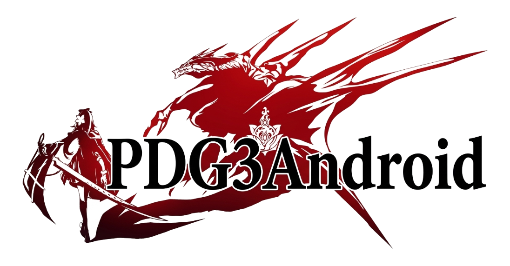
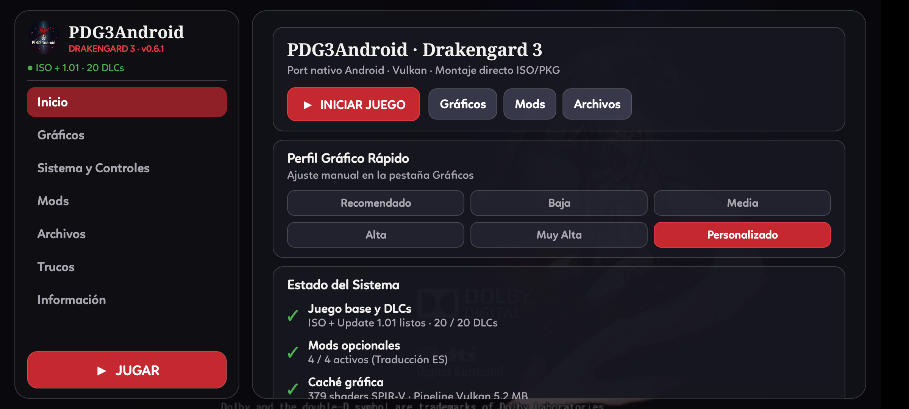
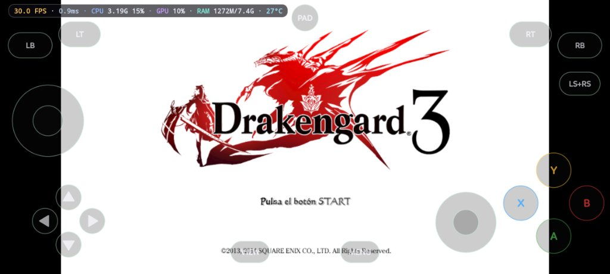
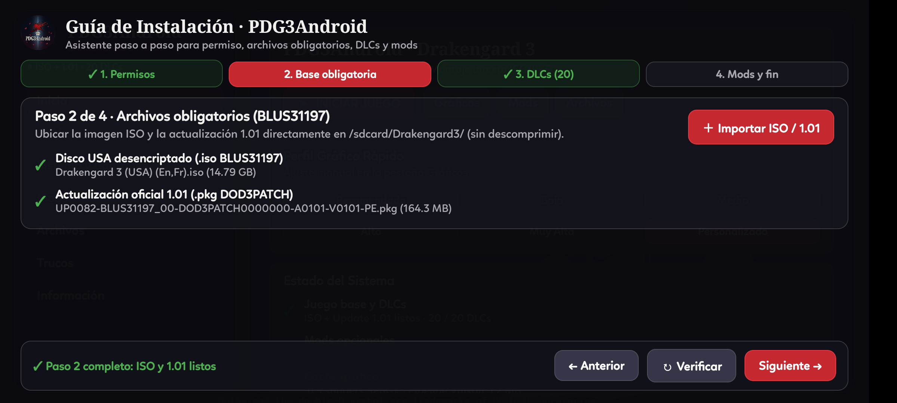
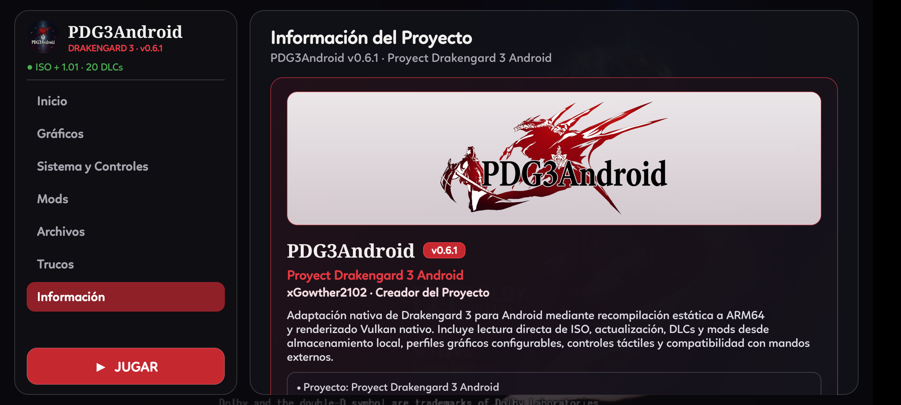
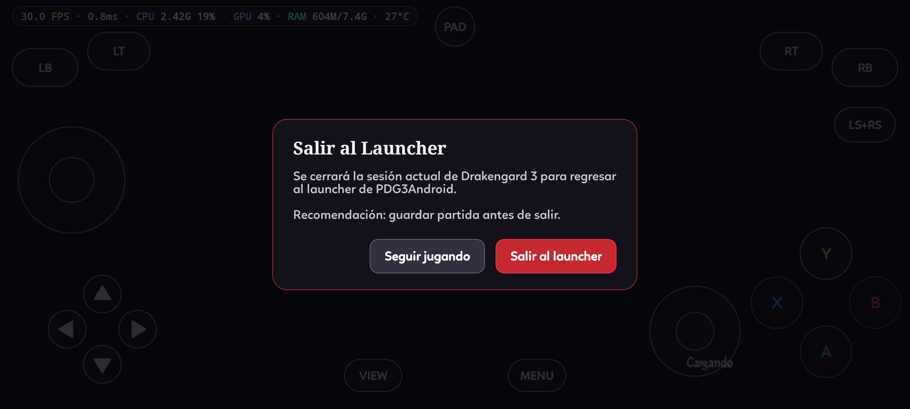

<p align="right">
  <b>Español</b> | <a href="README.en.md">English</a>
</p>

# PDG3Android — Proyect Drakengard 3 Android (PS3 → Android ARM64)

<p align="center">
  
</p>

> **Estado del proyecto:** **En desarrollo activo (`v0.6.1`)** — Funcional y jugable, con mejoras continuas de rendimiento Vulkan y launcher nativo.  
> **Creador del port Android:** `xGowther2102` · Basado en el trabajo original de recompilación [dod3-recomp](https://github.com/soyjxck/dod3-recomp) y [ps3recomp](https://github.com/soyjxck/ps3recomp).

**PDG3Android** es un port nativo de **Drakengard 3 (BLUS31197)** para Android mediante **recompilación estática PPU/SPU a ARM64** en lugar de emulación tradicional. Las funciones originales del ejecutable de PlayStation 3 se traducen a C++ nativo de 64 bits sobre una implementación propia HLE, **Vulkan nativo**, **SPIR-V**, audio MP3/PCM y sistema de archivos virtual con lectura directa de ISO, `.pkg` y mods sin descomprimir.

---

## Componentes generales y repositorios base

### Arquitectura y herramientas generales
* **Recompilación estática PPU / SPU a ARM64:** traducción de ejecutables PS3 a C++ nativo ejecutado directamente sobre la CPU sin interpretación JIT.
* **Renderizado Vulkan Nativo + SPIR-V + PSO Cache:** compilación en caché persistente, descriptor sets optimizados y shaders de post-procesado.
* **Sistema de archivos virtual directo (VFS):** lectura al vuelo desde ISO desencriptada, Update `1.01`, DLCs `.pkg` y mods `.pkg` / `.zip` en `/sdcard/Drakengard3/`.
* **Entrada híbrida SDL2 + plantillas táctiles:** compatibilidad con mandos Bluetooth/USB mediante `gamecontrollerdb.txt` y controles táctiles adaptativos.
* **Cadena de compilación Android (`arm64-v8a`):** Android NDK (Clang/LLVM), CMake, Ninja y Gradle con aislamiento de proceso `:game` y sistema de diagnóstico.

### Repositorios utilizados y créditos técnicos
* **★ [dod3-recomp](https://github.com/soyjxck/dod3-recomp) *(Repositorio principal)*:** lifting estático de Drakengard 3, parches del motor Unreal Engine 3 y launcher base.
* **[ps3recomp (Fork principal)](https://github.com/soyjxck/ps3recomp):** implementación HLE de syscalls LV2, VFS virtual, audio y backend Vulkan / SPIR-V.
* **[ps3recomp (Proyecto original — `sp00nznet`)](https://github.com/sp00nznet/ps3recomp):** arquitectura base del recompilador estático de PlayStation 3.
* **[SDL2](https://github.com/libsdl-org/SDL):** capa multimedia Android para ventana, audio e integración táctil/mandos.
* **[SDL_GameControllerDB](https://github.com/mdqinc/SDL_GameControllerDB):** definiciones comunitarias de mapeo para controles Xbox, PlayStation, Switch y genéricos en Android.
* **[glslang · SPIRV-Tools · SPIRV-Cross](https://github.com/KhronosGroup/glslang):** traducción y optimización de shaders RSX/HLSL a bytecode SPIR-V para Vulkan.
* **[ps3libraries](https://github.com/ps3dev/ps3libraries):** referencia de librerías y utilidades del ecosistema homebrew PS3.
* **[minimp3](https://github.com/lieff/minimp3) & zlib:** decodificación de pistas de audio MP3 y descompresión nativa EdgeZlib.

---

## Capturas de muestra

| Launcher (`v0.6.1`) | En juego (HUD y controles táctiles) |
| :---: | :---: |
|  |  |

| Guía paso a paso | Información y Protagonista |
| :---: | :---: |
|  |  |

<p align="center">
  <b>Menú Salir al Launcher al pulsar Atrás</b><br />
  
</p>

---

## Características principales

### Motor nativo y renderizado Vulkan
* **Perfiles gráficos rápidos:** *Recomendado*, *Baja*, *Media*, *Alta*, *Muy Alta* y *Personalizado* accesibles desde *Inicio* y *Gráficos*.
* **Escalado y sincronización:** resolución configurable (`0.5x` a `2.0x`), límite de FPS (`30`, `60`, *Adaptativo*, *Sin límite*), V-Sync, FXAA, filtrado anisotrópico (`1x`–`16x`), sombras configurables (*Off* hasta *Ultra*), Post-FX, DoF, Motion Blur y distorsión de combate.
* **Caché de pipelines Vulkan y SPIR-V:** compila y persiste shaders en `/sdcard/Drakengard3/cache/` para reducir tirones durante los combates.
* **Medidor de rendimiento en juego:** barra HUD configurable con FPS, frametime (`ms`), carga/frecuencia de CPU, reloj/carga de GPU, RAM y temperatura.

### Gestor de archivos, DLCs y Mods
* **Lectura directa sin descomprimir:** lee la imagen `.iso` desencriptada (USA), actualización oficial `1.01` `.pkg`, los 20 paquetes DLC oficiales (`NPUB31251`, sin requerir `.rap`/`.edat`) y mods `.pkg` / `.zip`.
* **Asistente de instalación en 4 pasos:** verificación guiada al primer inicio (permisos, archivos obligatorios, DLCs opcionales y mods con alertas ante rutas incorrectas).
* **Separación estricta de carpetas y soporte Español:** activación o desactivación individual de paquetes opcionales en `/sdcard/Drakengard3/mods/` (incluidos parches de Traducción al Español y `MOVIES.ZIP`).

### Controles, diagnóstico y estabilidad
* **Controles híbridos:** botones táctiles configurables con plantillas visuales (*Auto*, *Xbox*, *PS3*, *PS4*, *PS5*, *Switch*), compatibilidad directa con mandos Bluetooth/USB (`SDL2` + `gamecontrollerdb.txt`) y mapeo del botón *View* en mandos Xbox a `SELECT`.
* **Regreso limpio al launcher:** al pulsar el botón o gesto **Atrás** durante la partida se abre la confirmación *Salir al Launcher* (`Seguir jugando` / `Salir al launcher`), liberando completamente el proceso `:game`.
* **Captura de errores y exportación `.txt`:** detección automática de excepciones Java y cierres nativos (`ApplicationExitInfo`) al reabrir el launcher, con diálogo para **copiar el informe al portapapeles** o **guardarlo en `.txt`** dentro de `/sdcard/Drakengard3/logs/`.

---

## Requisitos
* Android **8.0** o superior (`API 26+`, arquitectura **`arm64-v8a`**).
* GPU compatible con **Vulkan 1.1+**.
* ~17 GB de espacio libre para ISO base + Update 1.01 (hasta ~35 GB si se agregan los 20 DLCs y mods de traducción/cinemáticas).

### Dispositivos probados
* **POCO F3** — Probado y verificado.
* **POCO F8 Pro** — Próximo a probar (validación pendiente).

---

## Cómo instalar y jugar

### 1. Instalar la aplicación
* Descargar e instalar el archivo `PDG3Android-v0.6.1-release.apk` desde la sección **[Releases](../../releases/latest)**.

### 2. Preparar los archivos en la ruta exacta
En el almacenamiento interno del dispositivo (`Almacenamiento interno/Drakengard3/`), ubicar cada archivo en su carpeta dedicada:

```text
/sdcard/Drakengard3/
├── Drakengard 3 (USA) (En,Fr).iso                          ← OBLIGATORIO (.iso USA desencriptada BLUS31197)
├── UP0082-BLUS31197_00-DOD3PATCH0000000-A0101-V0101-PE.pkg  ← OBLIGATORIO (Update oficial 1.01)
├── dlc/                                                     ← OPCIONAL (paquetes DLC oficiales NPUB31251 .pkg)
├── mods/                                                    ← OPCIONAL (mods .pkg / .zip y Traducción ES + MOVIES.ZIP)
├── logs/                                                    ← Generada automáticamente (diagnósticos y errores .txt)
├── cache/                                                   ← Generada automáticamente (EBOOT_101.ELF, SPIR-V, PSO)
└── gamedata/                                                ← Generada automáticamente (partidas guardadas)
```

> [!IMPORTANT]
> Todos los archivos son aportados por el usuario desde sus propias copias de respaldo. El APK no incluye ISO, claves ni paquetes multimedia con derechos de autor.

### 3. Asistente inicial
1. Abrir **PDG3Android**.
2. Seguir la **Guía de Instalación (4 pasos)**:
   * **Paso 1:** Conceder permiso de acceso a todos los archivos.
   * **Paso 2:** Verificar o importar el archivo `.iso` base y el `.pkg` Update `1.01`.
   * **Paso 3:** Verificar o importar DLCs opcionales en `dlc/`.
   * **Paso 4:** Verificar o importar mods opcionales en `mods/` y finalizar.
3. Ajustar el perfil gráfico deseado en *Inicio* o *Gráficos* y pulsar **▶ JUGAR**.

---

## Historial de versiones

* **`v0.6.1` (Actual):**
  * Asistente de instalación renovado paso a paso en 4 etapas (*Permisos*, *Base obligatoria*, *DLCs* y *Mods/Resumen*).
  * Captura automática de fallos Java y cierres nativos con opciones para **copiar al portapapeles** o **guardar en `.txt`** dentro de `logs/` + exportación manual de diagnóstico desde *Archivos*.
  * Botón/gesto **Atrás** en juego con menú superpuesto para regresar limpiamente al launcher sin reiniciar el sistema.
  * Firma Release configurada (`keystore.properties` / variables `PDG3_*`) y organización del repositorio.
* **`v0.6.0`:**
  * Identidad completa **PDG3Android** (ícono adaptativo sin bordes blancos, banner del proyecto, pestaña *Información* con ficha de **Zero** y créditos de repositorios).
  * Medidor de rendimiento en tiempo real ampliado (FPS, ms, CPU, GPU, RAM, temperatura) y optimizaciones Vulkan/UE3 para combates exigentes.
  * Aislamiento de proceso del juego (`:game`) respecto al launcher y corrección de foco táctil tras bajar la barra de notificaciones.

---

## Compilación y estructura técnica

Las instrucciones detalladas para compilar el motor nativo (`libdod3.so`) y las variantes **Debug** / **Release** se encuentran en **[DEVELOPMENT.md](DEVELOPMENT.md)**.
